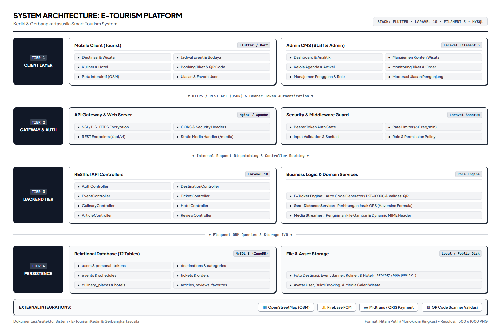

# 🌴 E-Tourism Platform (Gerbangkartasusila & Kediri Tourism)

<p align="center">
  
</p>

<p align="center">
  
  
  
  
  
  
</p>

---

## 📌 Tentang Proyek

**E-Tourism Platform** adalah solusi digital pariwisata terpadu yang dirancang untuk mempromosikan destinasi wisata, kebudayaan, event, kuliner khas, dan akomodasi di kawasan **Gerbangkartasusila** (Gresik, Bangkalan, Mojokerto, Surabaya, Sidoarjo, Lamongan) serta **Kediri Raya**.

Sistem ini mengintegrasikan **Aplikasi Mobile (Flutter)** untuk wisatawan dengan **Admin Dashboard (Laravel 10 & Filament 3)** untuk pengelola konten pariwisata secara real-time.

---

## ✨ Fitur Utama

### 📱 Aplikasi Mobile (Wisatawan)
* **Explore Destinasi Wisata**: Jelajahi wisata alam, budaya/sejarah, ikon kota, dan rekreasi dengan informasi jam operasional, harga tiket, dan galeri foto.
* **Peta Interaktif & Navigasi**: Integrasi OpenStreetMap via `flutter_map` dengan koordinat presisi.
* **Kalender Event & Festival**: Jadwal acara seni, karnaval, dan festival budaya terdekat.
* **Wisata Kuliner Khas**: Rekomendasi kuliner legendaris dan tempat makan terpopuler.
* **Hotel & Akomodasi**: Informasi penginapan, fasilitas, kontak, dan alamat.
* **Artikel & Berita Wisata**: Baca tips travelling dan wawasan budaya terkini.
* **E-Ticketing System**: Pemesanan tiket digital lengkap dengan simulasi QR Code tiket.
* **Favorites & Wishlist**: Simpan destinasi favorit untuk diakses sewaktu-waktu.
* **User Authentication & Profile**: Registrasi, Login, dan pembaruan profil pengguna.

### 💻 Admin Panel (Pengelola & Administrator)
* **Dashboard Statistik & Chart**: Visualisasi total data dan grafik pertumbuhan pengunjung/konten.
* **Manajemen Destinasi & Kategori**: CRUD lengkap informasi wisata beserta multi-image gallery.
* **Manajemen Event & Jadwal**: Pengaturan tanggal mulai, selesai, dan lokasi event.
* **Manajemen Kuliner & Hotel**: Pengelolaan data restoran khas dan penginapan.
* **Manajemen Artikel Wisata**: Rich-text editor untuk publikasi konten blog wisata.
* **Manajemen Tiket**: Monitoring tiket yang terbit dan riwayat booking.
* **Role & Permission Management**: Hak akses terstruktur menggunakan Spatie Permission & Filament Shield.

---

## 🏗 Arsitektur Sistem

```text
┌─────────────────────────────────────────────────────────┐
│                   Flutter Mobile App                    │
│      (Provider, Dio, Flutter Map, Flutter Animate)      │
└────────────────────────────┬────────────────────────────┘
                             │  REST API (JSON)
                             ▼
┌─────────────────────────────────────────────────────────┐
│               Laravel 10 Backend Engine                 │
│      (Sanctum Auth, REST Controllers, Media Proxy)      │
├────────────────────────────┬────────────────────────────┤
│    Filament 3 Dashboard    │    Spatie RBAC & Shield    │
└────────────────────────────┬────────────────────────────┘
                             │
                             ▼
┌─────────────────────────────────────────────────────────┐
│                     MySQL Database                      │
│   (Users, Destinations, Events, Culinary, Hotels, etc)  │
└─────────────────────────────────────────────────────────┘
```

---

## 🛠 Teknologi yang Digunakan

### Backend & API
| Teknologi | Versi / Keterangan |
| :--- | :--- |
| **PHP** | `^8.1` |
| **Framework** | Laravel 10 |
| **Admin Panel** | Filament v3.2 |
| **Role & Permission** | Spatie Laravel Permission & Filament Shield |
| **Autentikasi API** | Laravel Sanctum |
| **Database** | MySQL 8.0 |

### Mobile App (Frontend)
| Paket / Library | Fungsi |
| :--- | :--- |
| **Flutter SDK** | `>=3.0.0 <4.0.0` |
| **Provider** | State Management |
| **Dio** | HTTP Client & API Interceptor |
| **Flutter Map & LatLong2** | Peta Interaktif (OpenStreetMap) |
| **Flutter Animate** | Micro-interactions & Transisi Halus |
| **Cached Network Image** | Image Caching & Rendering |
| **Google Fonts** | Tipografi Modern (Poppins) |

---

## 📁 Struktur Direktori

```text
e-tourism/
├── backend/                  # Source code Laravel 10 & Filament 3 Admin
│   ├── app/
│   │   ├── Filament/         # Resource Filament, Pages, & Charts
│   │   ├── Http/Controllers/ # REST API Controllers
│   │   └── Models/           # Eloquent Models
│   ├── database/
│   │   ├── migrations/       # Skema Database (16 Migrations)
│   │   └── seeders/          # Database Seeder dengan Data Riil
│   ├── routes/
│   │   ├── api.php           # Endpoint REST API
│   │   └── web.php
│   └── composer.json
├── mobile/                   # Source code Flutter Mobile App
│   ├── lib/
│   │   ├── models/           # Data Models (Destination, Event, dsb.)
│   │   ├── screens/          # Halaman UI (Home, Detail, E-Ticket, dsb.)
│   │   ├── services/         # API Client (Dio) & Networking
│   │   ├── theme/            # Styling, Colors & Typography
│   │   ├── widgets/          # Komponen Reusable
│   │   └── main.dart         # Entry Point Aplikasi
│   └── pubspec.yaml
├── docs/                     # Dokumentasi Desain & Arsitektur
│   ├── design.md             # Dokumen Spesifikasi Desain Lengkap
│   └── system_architecture.png
└── README.md                 # Dokumentasi Utama Proyek
```

---

## 🚀 Panduan Instalasi & Menjalankan Aplikasi

### 📋 Prasyarat
Pastikan sistem Anda telah terpasang:
* **PHP >= 8.1** & **Composer**
* **MySQL Database** (misal via XAMPP)
* **Flutter SDK >= 3.0.0** & **Dart**
* **Git**

---

### 1️⃣ Konfigurasi Backend (Laravel & Filament)

1. Masuk ke direktori `backend`:
   ```bash
   cd backend
   ```

2. Pasang dependensi PHP:
   ```bash
   composer install
   ```

3. Salin file environment dan atur koneksi database:
   ```bash
   cp .env.example .env
   ```
   Buka file `.env` dan sesuaikan konfigurasi database:
   ```env
   DB_CONNECTION=mysql
   DB_HOST=127.0.0.1
   DB_PORT=3306
   DB_DATABASE=e_tourism
   DB_USERNAME=root
   DB_PASSWORD=
   ```

4. Generate Application Key & jalankan migration beserta data seeder:
   ```bash
   php artisan key:generate
   php artisan migrate --seed
   ```

5. Buat symbolic link untuk storage media:
   ```bash
   php artisan storage:link
   ```

6. Jalankan server lokal Laravel:
   ```bash
   php artisan serve
   ```
   * REST API Base URL: `http://127.0.0.1:8000/api`
   * Filament Admin Dashboard: `http://127.0.0.1:8000/admin`

---

### 2️⃣ Akun Pengguna Bawaan (Default Credentials)

| Role | Email | Password | Akses |
| :--- | :--- | :--- | :--- |
| **Super Admin** | `admin@example.com` | `password` | Admin Dashboard (Filament) & Mobile |
| **Demo User** | `rkriswibowo@gmail.com` | `password` | Mobile App |

---

### 3️⃣ Konfigurasi Mobile App (Flutter)

1. Masuk ke direktori `mobile`:
   ```bash
   cd mobile
   ```

2. Unduh paket dependensi Flutter:
   ```bash
   flutter pub get
   ```

3. **Konfigurasi IP Backend** *(Opsional)*:
   Jika menjalankan pada perangkat fisik Android/iOS, sesuaikan IP backend pada file `lib/services/api_service.dart`:
   ```dart
   static String get host {
     if (kIsWeb) return 'http://localhost:8000';
     // Ganti dengan IP LAN komputer Anda jika menggunakan device fisik
     return 'http://10.0.2.2:8000'; // Emulator Android
   }
   ```

4. Jalankan aplikasi:
   ```bash
   # Jalankan di Chrome (Web)
   flutter run -d chrome

   # Atau jalankan di Emulator Android / Device fisik
   flutter run
   ```

---

## 📡 Dokumentasi Endpoint REST API

Semua endpoint mengembalikan respons standar dalam format **JSON**.

### 🔐 Autentikasi
| Method | Endpoint | Keterangan |
| :--- | :--- | :--- |
| `POST` | `/api/login` | Login user & generate Sanctum token |
| `POST` | `/api/register` | Pendaftaran user baru |
| `POST` | `/api/logout` | Logout & revoke token |
| `GET` | `/api/profile` | Ambil data profil user saat ini |
| `POST` | `/api/profile/update` | Update nama / profil pengguna |

### 🏞 Destinasi & Kategori
| Method | Endpoint | Keterangan |
| :--- | :--- | :--- |
| `GET` | `/api/destinations` | Daftar seluruh destinasi wisata |
| `GET` | `/api/destinations/featured` | Daftar destinasi unggulan/rekomendasi |
| `GET` | `/api/destinations/category/{slug}` | Filter destinasi berdasarkan kategori |
| `GET` | `/api/destinations/{id}` | Detail destinasi spesifik |

### 🎟 E-Ticket & Transaksi
| Method | Endpoint | Keterangan |
| :--- | :--- | :--- |
| `GET` | `/api/tickets` | Daftar tiket yang dimiliki pengguna |
| `POST` | `/api/tickets` | Booking / pemesanan tiket baru |
| `GET` | `/api/tickets/{id}` | Detail tiket beserta kode verifikasi |

### 🎪 Event, Kuliner, Hotel & Artikel
| Method | Endpoint | Keterangan |
| :--- | :--- | :--- |
| `GET` | `/api/events` | Daftar event pariwisata mendatang |
| `GET` | `/api/events/{id}` | Detail event |
| `GET` | `/api/culinary` | Daftar tempat kuliner khas |
| `GET` | `/api/culinary/{id}` | Detail kuliner |
| `GET` | `/api/hotels` | Daftar hotel & akomodasi |
| `GET` | `/api/hotels/{id}` | Detail hotel |
| `GET` | `/api/articles` | Daftar artikel berita & tips wisata |
| `GET` | `/api/articles/{id}` | Detail artikel lengkap |

---

## 🤝 Kontribusi & Pengembangan
Kontribusi selalu terbuka! Silakan lakukan *fork* pada repositori ini dan ajukan *Pull Request* dengan perubahan yang rapi dan terdokumentasi.

---

## 📄 Lisensi
Proyek ini dilisensikan di bawah **MIT License**.
